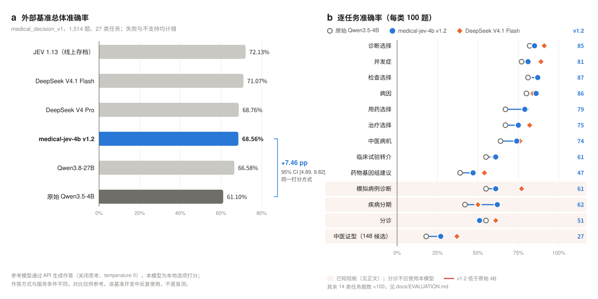

<div align="center">

# medical-jev-train

**非官方、开源、可本地运行的医疗版 JEV 模型**

给它一段病例和几个选项，它返回一个答案和每个选项的概率。一张显卡就能跑。

<sub>JEV 是 TypeSafe 的结构化判断 API。本项目沿用这种“传入材料和问题，直接返回判断”的用法，与 JEV / TypeSafe 官方无关联。</sub>

[](https://huggingface.co/JuneYao/medical-jev-4b/tree/v1.2.0)
[](https://huggingface.co/datasets/JuneYao/medical-jev-data)
[](LICENSE)
[](https://linux.do/)
[](#不能用来做什么)

**简体中文** · [English](README_en.md)

[模型](#模型) · [看个例子](#看个例子) · [效果如何](#效果如何) · [快速开始](#快速开始) · [不能用来做什么](#不能用来做什么) · [技术细节](#技术细节) · [社区](#社区)

</div>

## 为什么做这个

很多医学判断可以写成选择题：最可能是什么病，方案有没有禁忌，下一步做什么检查。这类任务不需要模型写长文，需要的是**答案可解析、概率可读取、能离线运行、成绩可复查**。

这个仓库提供可直接下载使用的模型 **medical-jev-4b**，也包含完整流程：数据去泄漏、LoRA 训练、外部基准评测、其他领域回归检查和带哈希校验的发布包。适合**医学教学题库、AI 模型评测和离线研究**。

## 模型

| 模型 | 基础模型 | 外部基准 | 留出测试 | 运行要求 | 下载 |
| --- | --- | ---: | ---: | --- | --- |
| **medical-jev-4b** v1.2.0 | Qwen3.5-4B | **68.56%** | **80.92%** | 单张 NVIDIA 显卡 | [Hugging Face](https://huggingface.co/JuneYao/medical-jev-4b/tree/v1.2.0) |

## 看个例子

> **病例**：患者发热、咳嗽，甲型流感核酸阳性，新冠核酸阴性。
>
> **规则**：甲流阳性选甲型流感，新冠阳性选新冠感染，两项都阴性选证据不足。

| 选项 | 模型给出的概率 |
| --- | ---: |
| **甲型流感（模型的选择）** | **97.43%** |
| 新冠感染 | 1.53% |
| 证据不足 | 1.04% |

这道题的答案写在规则里，只用来演示用法。概率停在 97% 左右，主要是因为训练时用了 0.05 的 label smoothing。更多场景见[调用示例](examples/README.md)。

## 效果如何

外部基准共 **1,514 道题、27 类任务**。训练后比原始模型多答对 **113 题**。

| 模型 | 答对题数 | 正确率 | 运行方式 |
| --- | ---: | ---: | --- |
| JEV 1.13 | 1,092 | 72.13% | 线上接口 |
| DeepSeek V4.1 Flash | 1,076 | 71.07% | 线上接口 |
| DeepSeek V4 Pro | 1,041 | 68.76% | 线上接口 |
| **medical-jev-4b** | **1,038** | **68.56%** | **本地显卡** |
| Qwen3.8-27B | 1,008 | 66.58% | 线上接口 |
| Qwen3.5-4B（训练前） | 925 | 61.10% | 本地显卡 |

- **留出测试**：1,557 题上从 75.47% 提高到 **80.92%**（+5.46 个百分点，95% 区间 3.47 到 7.60）。
- **擅长**：检查选择（87%）、病因（86%）、诊断（85%）、并发症（81%）、用药选择（79%）。
- **不擅长**：药物基因组建议（47%）、分诊（51%）、148 个选项的中医证型题（27%）。
- **其他领域**：MMLU / CMMLU 的 124 个学科在多重比较校正后没有显著退步。非医学学科平均提高 5.45 个百分点，说明部分提升来自通用答题能力。

> [!NOTE]
> 68.56% 需要开启超多选项模式。默认设置不支持其中 100 道题，这些题算错，正确率为 **66.78%**。外部基准和留出题在开发中都被分析过，不是严格盲测。线上模型和本地模型作答方式不同，表格仅供参考。

## 快速开始

**你需要**：一张 NVIDIA 显卡、Python 3.12，以及约 10 GB 磁盘空间。我们在 Linux、RTX 5090 32 GB 上验证过。

### 1. 安装并下载模型

```bash
python3 -m venv .venv && source .venv/bin/activate
pip install torch==2.8.0 --index-url https://download.pytorch.org/whl/cu128
pip install huggingface-hub==1.33.0

hf download JuneYao/medical-jev-4b --revision v1.2.0 --local-dir medical-jev-4b
pip install -r medical-jev-4b/requirements.txt
```

第一次运行时会自动下载约 9.3 GB 的基础模型 Qwen3.5-4B，并校验版本和哈希。

### 2. 写一道题

输入文件是 JSONL，**每行一道题**：

```bash
cat > my_questions.jsonl <<'EOF'
{"id":"q1","request":{"state":{"case":"患者发热、咳嗽，甲型流感核酸阳性，新冠核酸阴性。"},"questions":{"decision":{"type":"choice","instructions":"根据检测结果选择最可能的诊断。","criteria":{"flu_a":"甲型流感","covid":"新冠感染","unknown":"证据不足"}}}}}
EOF
```

| 字段 | 含义 |
| --- | --- |
| `id` | 题目编号，会原样出现在结果里 |
| `state` | 病例、检查结果等材料，键名可以自己定 |
| `instructions` | 要模型判断什么，以及判断规则 |
| `criteria` | 候选项，格式为 `选项键: 选项内容`，默认支持 2–52 个 |

### 3. 运行

```bash
python medical-jev-4b/predict_choices.py --bundle medical-jev-4b \
  --input my_questions.jsonl --output predictions.jsonl
cat predictions.jsonl
```

### 4. 读结果

```json
{"id": "q1", "status": "ok", "answer": "flu_a", "probabilities": {"flu_a": 0.9739, "covid": 0.0144, "unknown": 0.0117}}
```

`answer` 是模型选中的选项键，`probabilities` 是各选项的概率（这里保留四位小数）。`status` 为 `ok` 表示这道题正常完成。概率没有校准，只适合比较选项，不能当作风险评分。

### 在 Python 里调用

```python
import sys
sys.path.insert(0, "medical-jev-4b")
from jevtrain.inference import ChoicePredictor

model = ChoicePredictor("medical-jev-4b")  # 已有基础模型时，第二个参数传路径
request = {
    "state": {"case": "患者发热、咳嗽，甲型流感核酸阳性，新冠核酸阴性。"},
    "questions": {"decision": {
        "type": "choice",
        "instructions": "根据检测结果选择最可能的诊断。",
        "criteria": {"flu_a": "甲型流感", "covid": "新冠感染", "unknown": "证据不足"},
    }},
}
result = model.predict([request])[0]
print(result["answer"], result["probabilities"])
```

### 常见问题

| 情况 | 做法 |
| --- | --- |
| 显存不够 | 加 `--batch-size 1` |
| 已下载过基础模型 | 加 `--base-model /path/to/Qwen3.5-4B` |
| 超过 52 个选项 | 用本仓库的 `scripts/predict_choices.py --tournament-above 52`（实验性） |
| 想用 PEFT 加载 | 不支持。权重是自定义格式，请用 `predict_choices.py` 或 `ChoicePredictor` |

## 不能用来做什么

> [!WARNING]
> **不要把它用于真实患者的诊断、分诊或治疗决策。** 它的输出不能替代医生的判断。

- **不要用它做分诊。** 它的分诊正确率只有 51%，低于训练前（55%）。它在信息不足的第一轮对话里很少追问，52 题只答对 16 题，可能漏掉紧急情况。
- **不要把概率当成真实把握。** 模型说 97% 不代表它有 97% 的可能答对，这个数字不能用作风险评分。
- **训练数据没有经过临床专家逐条审核。** 数据里的错误可能被模型学到。
- **它不会解释原因。** 模型只给选项和概率，你无法从输出里看到判断依据。

## 技术细节

下面的内容面向想了解训练方法或复现结果的读者。

<details>
<summary><b>模型是怎么做的</b></summary>

1. **只打分，不生成文字。** 选项编成 A、B、C…，模型只计算下一个 token 是各字母的概率。一次前向计算就能得到答案和完整概率分布，也不会输出选项以外的内容。
2. **按任务均衡抽样。** 训练池里 CMB 一个来源就有 195,784 题，全量训练会淹没小任务。因此每类任务最多取 3,000 题，通用医学题取 10,000 题，实际训练 44,347 题。
3. **去泄漏和严格计分。** 训练前删除与开发集、留出测试、外部基准重复或高度相似（5-gram Jaccard ≥ 0.8）的题，以及答案互相矛盾的题，共 307 条；失败和不支持的题都算错；与原始 4B 逐题配对做 bootstrap。

<p align="center"></p>

**a**，77 个公开题源统一成选择题 JSON，映射到 27 类决策任务。**b**，冻结 Qwen3.5-4B，在全部 32 层上训练 LoRA，损失只算答案字母的 logits；每 500 步在开发集上评测，选出第 5,000 步。**c**，推理时读出各字母概率并归一化；选项超过 52 个时分组筛选。

</details>

<details>
<summary><b>完整评测口径</b></summary>

<p align="center"></p>

- **基准**：[jev-healthcare-lab](https://github.com/JuneYaooo/jev-healthcare-lab) `medical_decision_v1`，与训练数据隔离，但开发中用于诊断问题，不是盲测。
- **比训练前提高多少**：正确率提高 7.46 个百分点。考虑题目抽样带来的波动，提升幅度大约在 4.89 到 9.82 个百分点之间（95% 置信区间）。
- **默认设置的成绩**：默认最多支持 52 个选项，超过的题直接算错。此时本模型答对 1,011 题（66.78%），原始模型答对 907 题（59.91%）。
- **概率准不准**：没有校准。模型给出的把握和实际正确率平均相差约 15 个百分点（ECE 0.146）。
- **留出测试**：1,557 题上本模型答对 1,260 题（80.92%），原始 4B 答对 1,175 题（75.47%），差值 +5.46 个百分点，95% 区间 [3.47, 7.60]。训练池已删除与这些题重复和高度相似的题，但发布前分析过其中的错题，因此不算盲测。
- **参考模型**：API 模型为生成作答，DeepSeek 关闭思考，JEV 1.13 为线上服务存档；原始记录在 jev-healthcare-lab 的 `results/clinical-v1`。

| 任务 | 原始 4B | **本模型** | DeepSeek Flash | DeepSeek Pro | JEV 1.13 |
| --- | ---: | ---: | ---: | ---: | ---: |
| 诊断选择 | 82 | **85** | 91 | 91 | 89 |
| 并发症 | 77 | **81** | 89 | 89 | 93 |
| 检查选择 | 81 | **87** | 81 | 74 | 88 |
| 病因 | 80 | **86** | 84 | 84 | 84 |
| 用药选择 | 67 | **79** | 80 | 72 | 83 |
| 治疗选择 | 67 | **75** | 82 | 74 | 78 |
| 中医病机 | 64 | **74** | 76 | 79 | 67 |
| 临床试验转介 | 55 | **61** | 60 | 58 | 53 |
| 药物基因组建议 | 39 | **47** | 54 | 51 | 55 |
| 模拟病例诊断（DDXPlus） | 55 | **61** | 77 | 71 | 70 |
| 疾病分期 | 42 | **62** | 50 | 53 | 62 |
| 分诊 | 55 | **51** | 61 | 57 | 63 |
| 中医证型（148 候选） | 18 | **27** | 37 | 30 | 38 |

短板原因：分诊没有进入训练，训练数据也几乎没有“信息不足时先追问”的样本；模拟病例诊断有 49 个选项，超过训练时见过的最多 26 个；中医证型有 148 个选项，只能分组筛选；药物基因组建议依赖细致的指南规则。全部任务见[逐任务成绩](docs/EVALUATION.md#逐任务成绩)。

</details>

<details>
<summary><b>模型规格</b></summary>

| 项目 | 说明 |
| --- | --- |
| 基础模型 | Qwen3.5-4B |
| 适配器 | 全 32 层 LoRA（rank 16 / alpha 32，第 5,000 步），约 130 MB |
| 权重 SHA-256 | `130a4cc0…7e4bc3` |
| 任务 | 诊断、病因、并发症、检查、治疗、用药、禁忌、药物基因组、分诊、消息优先级、护理、营养、康复、中医证型 / 病机等 27 类 |
| 选项数 | 训练时见过 2–26 个；默认最多支持 52 个；更多选项需开启超多选项模式（实验性） |
| 输入长度 | 训练时最长 1,536 token；使用时最长 8,192 token |
| 语种 | 中文为主，含英、日、韩、葡、西、土等 |
| 部署 | FP16 单卡，自动校验基础模型版本与哈希 |

</details>

<details>
<summary><b>复现训练</b></summary>

```bash
pip install -e . && pip install -r requirements-train.txt
hf download --repo-type dataset JuneYao/medical-jev-data --local-dir work/data/release
# 另需按 docs/EVALUATION.md 生成 work/benchmark/medical_decision_v1.jsonl
python scripts/build_clean_data.py .
jev train --config configs/jev/release/train.json --output runs/train
jev eval  --config configs/jev/release/train.json --checkpoint runs/train/best.safetensors \
  --input work/benchmark/medical_decision_v1.jsonl --max-options 52 --max-tokens 8192 \
  --tournament-above 52 --batch-size 1 --output runs/bench
```

RTX 5090 上训练约 1.4 小时。清洗脚本可逐字节复现本版本的训练集和开发集。README 的图由 `python scripts/make_readme_figures.py` 生成。

</details>

<details>
<summary><b>项目背景</b></summary>

TypeSafe 的 JEV 提供一种结构化判断 API：传入上下文和类型化问题，直接返回判断结果。本项目想回答：同样的选择题判断，一个开源、本地运行的 4B 模型能做到什么程度？模型直接接收 [jev-healthcare-lab](https://github.com/JuneYaooo/jev-healthcare-lab) 基准的请求格式。本项目与 JEV 官方无关联。

</details>

## 资源

| 内容 | 链接 |
| --- | --- |
| 模型 | [Hugging Face](https://huggingface.co/JuneYao/medical-jev-4b/tree/v1.2.0) |
| 数据（242,921 题，77 个来源） | [Hugging Face](https://huggingface.co/datasets/JuneYao/medical-jev-data) |
| 评测基准 | [jev-healthcare-lab](https://github.com/JuneYaooo/jev-healthcare-lab) |
| 逐题结果 | [docs/results](docs/results/README.md) |
| 详细文档 | [评测](docs/EVALUATION.md) · [训练](docs/TRAINING.md) · [数据](docs/DATA.md) · [输入范围](docs/INPUT_LIMIT_CHECK.md) · [模型卡](docs/MODEL_CARD_V1.md) · [发布报告](docs/RELEASE_V1.md) · [版本记录](CHANGELOG.md) |

## 社区

欢迎到 [LINUX.DO](https://linux.do/) 交流使用体验和训练经验。Bug 和功能建议请提交 [Issues](https://github.com/JuneYaooo/medical-jev-train/issues)。

## 许可

代码与模型适配器采用 [Apache-2.0](LICENSE)，此前以 MIT 发布部分的原声明保留在 [NOTICE](NOTICE)。基础模型 Qwen3.5-4B 同样采用 [Apache-2.0](https://huggingface.co/Qwen/Qwen3.5-4B/blob/main/LICENSE)。训练数据沿用各来源的上游许可，使用前请自行核对。
