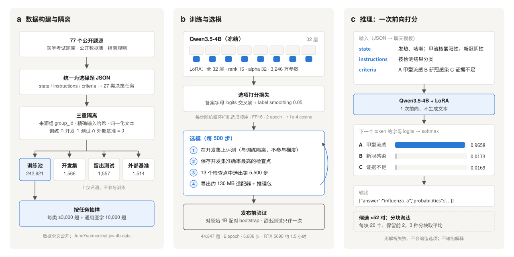
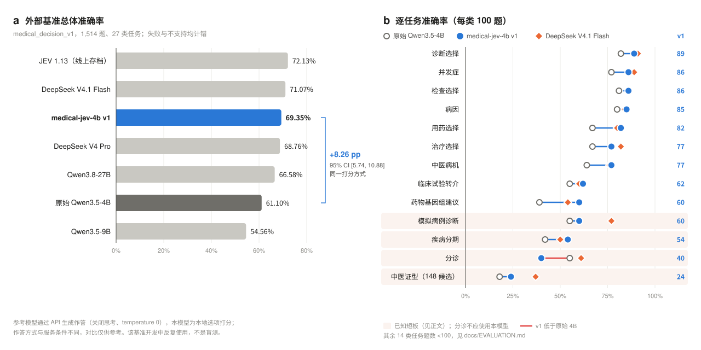

# medical-jev-4b：本地 4B 的医疗快速决策模型

给一段病例和几个候选项，模型一次前向就选出答案，并给出每个选项的概率。

4B 参数，单卡本地跑。在 1,514 道、27 类医疗决策题上答对 **69.35%**，和 DeepSeek V4 Pro（68.76%）在一个水平。适合教学题库、模型评测和离线研究，**不用于临床决策**。

[模型权重](https://huggingface.co/JuneYao/medical-jev-4b) · [训练数据](https://huggingface.co/datasets/JuneYao/medical-jev-4b-data) · [评测基准](https://github.com/JuneYaooo/jev-healthcare-lab) · [完整评测](docs/EVALUATION.md) · [训练方法](docs/TRAINING.md) · [版本记录](CHANGELOG.md)

| 外部基准准确率 | 相对原始 4B | 单卡速度 | 调用成本 |
| :---: | :---: | :---: | :---: |
| **69.35%** | **+8.26 pp** | **约 54 题/秒** | **无 API 费用** |
| 1,050 / 1,514 题 | 95% 区间 [5.74, 10.88] | RTX 5090 | 适配器 130 MB |

## 1. 为什么做

医疗流程里有很多范围明确的判断：分诊到哪一级、方案有没有禁忌、下一步做什么检查、能不能转介某个试验。这类判断不需要长篇解释，要的是三点：**快、稳、程序能直接读**。

TypeSafe 的 JEV 把它做成了 API：传入上下文（`state`）和类型化问题，直接返回结构化判断，官方叫它 “System One” 模型。[jev-healthcare-lab](https://github.com/JuneYaooo/jev-healthcare-lab) 用 1,514 道医疗题测过 JEV、DeepSeek 和 Qwen。

那么，同样的 Choice 判断，一个开源、本地跑的 4B 模型能做到什么程度？本项目回答的就是这个问题。模型直接接收这个基准的请求格式，在同一套题上比。本项目与 JEV 官方无关联。

## 2. 核心思路

先看一次调用。输入一道题：

```json
{"id": "teaching_diagnosis",
 "request": {
   "state": {"clinical_question": "教学病例：患者发热、咳嗽，检测报告为甲型流感病毒核酸阳性，新冠病毒核酸阴性。"},
   "questions": {"decision": {
     "type": "choice",
     "instructions": "本题按检测结果分类：甲型流感核酸阳性选择甲型流感，新冠核酸阳性选择新冠感染，两项均阴性选择证据不足。",
     "criteria": {"influenza_a": "甲型流感", "covid19": "新冠感染", "insufficient_evidence": "证据不足"}}}}}
```

当前版本 v1.1.0 的实测输出：

```json
{"id":"teaching_diagnosis","status":"ok","answer":"influenza_a","probabilities":{"influenza_a":0.9658,"covid19":0.0173,"insufficient_evidence":0.0169}}
```

即：`state` 放材料，`instructions` 放判断规则，`criteria` 列出选项；模型只在给定选项里挑一个，并给出概率分布。（这道题的答案由规则直接给出，只用来演示格式。）

做法就三点：

1. **打分，不生成。** 候选项编成 A、B、C…，只读下一个 token 在这几个字母上的概率。一次前向就拿到答案和完整分布，不会冒出非法选项，也不用解析文本。代价是没有解释。
2. **按任务均衡抽样。** 训练池里 CMB 一个来源就有 195,784 题，直接全训，小任务会被淹没。于是每类任务最多取 3,000 题，通用医学题取 10,000 题，实际训练 44,847 题。
3. **评测从严。** 训练、开发、测试和外部基准按来源组、精确输入、归一化文本三重隔离；失败和不支持的题一律算错；和原始 4B 逐题配对做 bootstrap。

<p align="center"></p>

**图 1｜方法总览。** **a**，77 个公开题源统一成选择题 JSON，映射到 27 类决策任务；四套数据三重隔离，再按任务抽样。**b**，冻结 Qwen3.5-4B，在全部 32 层上训练 LoRA，损失只算答案字母的 logits；每 500 步在开发集上评测，选出第 5,500 步；发布前与原始 4B 配对比较，留出测试只评一次。**c**，推理时一次前向读出各字母概率并归一化；候选超过 52 个时分块淘汰。

## 3. 效果

<p align="center"></p>

**图 2｜外部基准结果。** **a**，1,514 题总体准确率，所有模型都以全部题目为分母。**b**，题数为 100 的 13 类任务；连线是从原始 4B 到本模型的变化，红线表示低于原始 4B，浅色底是已知短板。

| 模型 | 答对 / 1,514 | 准确率 | 作答方式 |
| --- | ---: | ---: | --- |
| JEV 1.13（线上服务存档） | 1,092 | 72.13% | API 生成 |
| DeepSeek V4.1 Flash | 1,076 | 71.07% | API 生成，关闭思考 |
| **medical-jev-4b v1.1.0** | **1,050** | **69.35%** | 本地选项打分 |
| DeepSeek V4 Pro | 1,041 | 68.76% | API 生成，关闭思考 |
| Qwen3.8-27B | 1,008 | 66.58% | API 生成 |
| 原始 Qwen3.5-4B | 925 | 61.10% | 本地选项打分 |
| Qwen3.5-9B | 826 | 54.56% | API 生成，16 题限流失败计错 |

几点口径：

- **基准**：[jev-healthcare-lab](https://github.com/JuneYaooo/jev-healthcare-lab) `medical_decision_v1`，与训练数据三重隔离。开发中反复用它看问题，所以**不是盲测**。
- **计分**：无效回答、失败、不支持都算错。148 个候选的 100 道中医证型题用分块淘汰；如果直接算错（发布包默认），本模型是 1,028（67.90%），原始 4B 是 907（59.91%）。
- **可比性**：API 模型是生成作答，本模型是本地打分，服务条件也不同，对比仅供参考。参考模型的原始记录在 jev-healthcare-lab 的 `results/clinical-v1`。
- **留出测试**：与训练同分布的 1,557 题上，本模型 84.05%，原始 4B 75.50%（+8.55 pp，区间 [6.53, 10.42]）。训练池含这些题的上游来源，不能算盲测，详见[完整评测](docs/EVALUATION.md#训练分布内留出测试)。

<details>
<summary>逐任务准确率（≥100 题的 13 类任务，%）</summary>

| 任务 | 原始 4B | **本模型** | DeepSeek Flash | DeepSeek Pro | JEV 1.13 |
| --- | ---: | ---: | ---: | ---: | ---: |
| 诊断选择 | 82 | **89** | 91 | 91 | 89 |
| 并发症 | 77 | **86** | 89 | 89 | 93 |
| 检查选择 | 81 | **86** | 81 | 74 | 88 |
| 病因 | 80 | **85** | 84 | 84 | 84 |
| 用药选择 | 67 | **82** | 80 | 72 | 83 |
| 治疗选择 | 67 | **77** | 82 | 74 | 78 |
| 中医病机 | 64 | **77** | 76 | 79 | 67 |
| 临床试验转介 | 55 | **62** | 60 | 58 | 53 |
| 药物基因组建议 | 39 | **60** | 54 | 51 | 55 |
| 模拟病例诊断（DDXPlus） | 55 | **60** | 77 | 71 | 70 |
| 疾病分期 | 42 | **54** | 50 | 53 | 62 |
| 分诊 | 55 | **40** | 61 | 57 | 63 |
| 中医证型（148 候选） | 18 | **24** | 37 | 30 | 38 |

全部 27 类见 [docs/EVALUATION.md](docs/EVALUATION.md#逐任务成绩)。

</details>

### 已知短板

| 任务 | 现状 | 原因 |
| --- | --- | --- |
| 分诊 | 40/100，低于原始 4B；90% 预测为“非紧急就医” | 训练标签多由医生回复映射而来，以“非紧急就医”为主 |
| 模拟病例诊断 | 60%，落后 DeepSeek Flash 17 个百分点 | 49 个候选超过训练上限 26，训练里没有这类题 |
| 中医证型 | 24%，所有模型都低于 40% | 148 个候选，只能分块淘汰 |
| 疾病分期 | 54% | 题目依赖细致的分期标准 |

分诊为什么反而比原始 4B 低？训练标签大多是“非紧急就医”，模型学会了偏向这一类。所以**不要用它做分诊**。另外概率没有校准（基准 ECE 0.13），不能直接当风险或复核阈值。

## 4. 快速开始

Python 3.12、CUDA 12.8 版 PyTorch，已在 Linux / RTX 5090 32 GB 上验证。

```bash
python3 -m venv .venv && source .venv/bin/activate
pip install torch==2.8.0 --index-url https://download.pytorch.org/whl/cu128
pip install huggingface-hub==1.33.0
hf download JuneYao/medical-jev-4b --revision v1.1.0 --local-dir medical-jev-4b
pip install -r medical-jev-4b/requirements.txt
python medical-jev-4b/predict_choices.py --bundle medical-jev-4b \
  --input medical-jev-4b/examples/scenarios.jsonl
```

跑自己的数据：`--input` 换成 JSONL 文件，每行一题，格式同第 2 节；`--output predictions.jsonl` 保存结果。

<details>
<summary>更多用法：Python 调用、已有底座、超过 52 个候选</summary>

```python
import sys; sys.path.insert(0, "medical-jev-4b")
from jevtrain.inference import ChoicePredictor
model = ChoicePredictor("medical-jev-4b")
print(model.predict([request]))   # request 即第 2 节 JSON 里的 "request"
```

- 已有底座用 `--base-model` 指定；显存不够加 `--batch-size 1`。
- 发布包直接打分最多 52 个候选；更多候选用本仓库的 `scripts/predict_choices.py --tournament-above 52`（分块淘汰）。
- 适配器是自定义的 `jev-lora-v1` 格式，要用随包的 `predict_choices.py` 或 `ChoicePredictor` 加载，不兼容 PEFT。

</details>

## 5. 能力与边界

| 项目 | 说明 |
| --- | --- |
| 任务 | 诊断、病因、并发症、检查、治疗、用药、禁忌、药物基因组、分诊、消息优先级、护理、营养、康复、中医证型 / 病机等 27 类 |
| 候选数 | 训练覆盖 2–26 个；发布包直接打分最多 52 个；更多候选可分块淘汰（实验性） |
| 长度 | 训练 1,536 token；发布包 8,192 token |
| 语种 | 中文为主，含英、日、韩、葡、西、土等 |
| 速度 | RTX 5090 发布包默认设置：直接打分的 1,414 题约 26 秒；批量 1、含分块淘汰时 1,514 题约 192 秒（含约 30 秒加载） |
| 部署 | FP16 单卡；首次运行自动下载约 9.3 GB 底座，并校验版本与哈希 |

## 6. 开源内容

| 内容 | 位置 | 说明 |
| --- | --- | --- |
| 模型 | [LoRA v1.1.0](https://huggingface.co/JuneYao/medical-jev-4b/tree/v1.1.0) | 全 32 层 LoRA（rank 16 / alpha 32，第 5,500 步），约 130 MB，附独立推理代码；SHA-256 `88c64b00…25b4b6` |
| 数据 | [medical-jev-4b-data](https://huggingface.co/datasets/JuneYao/medical-jev-4b-data) | 训练池 242,921 题（77 个来源），以及开发集和留出测试全文；每条保留来源、上游 ID 与许可 |
| 代码 | `src/jevtrain`、`scripts/` | 数据构建、训练、评测与配对比较 |
| 评测记录 | `docs/results/` | 外部基准与留出测试的逐题预测 |

数据有一点要说明：训练原始文件已丢失，公开的是重建的训练池。上游来源相同，各任务规模基本一致，但不逐条相同。各来源许可以上游为准，使用前请自行核对。

## 7. 训练复现

```bash
pip install -e . && pip install -r requirements-train.txt
hf download --repo-type dataset JuneYao/medical-jev-4b-data --local-dir work/data/release
jev train --config configs/jev/release/train.json --output runs/train
jev eval  --config configs/jev/release/train.json --checkpoint runs/train/best.safetensors \
  --input work/benchmark/medical_decision_v1.jsonl --max-options 52 --max-tokens 8192 \
  --tournament-above 52 --batch-size 1 --output runs/bench
```

抽样规则和超参数与当前版本一致，数据换成公开的重建训练池。RTX 5090 上约 1.5 小时。环境、自检和每一步的细节见[训练方法](docs/TRAINING.md)；README 的两张图由 `python scripts/make_readme_figures.py` 生成。

## 免责声明

本模型和数据只用于研究、教学与评测。训练标签未经临床专家逐条审核，概率未经校准；输出不能替代专业医疗判断，也不应用于真实患者的诊断、分诊或治疗决策。

## 引用

```bibtex
@misc{medical-jev-4b,
  title  = {medical-jev-4b: An Open Local Choice-Scoring Model for Medical Decisions},
  author = {JuneYaooo},
  year   = {2026},
  howpublished = {\url{https://github.com/JuneYaooo/medical-jev-train}}
}
```

## 许可

代码与 LoRA 适配器采用 [MIT](LICENSE)；底座 Qwen3.5-4B 采用 [Apache-2.0](https://huggingface.co/Qwen/Qwen3.5-4B/blob/main/LICENSE)。训练数据各来源保留其上游许可，代码许可不授予第三方数据使用权。
