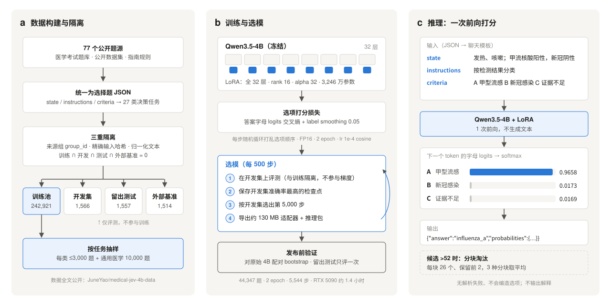

<div align="center">

# medical-jev-4b

**一个能在自己显卡上运行的医疗选择题模型**

给它一段病例和几个选项，它会选出一个答案，并告诉你每个选项的概率。

[](https://huggingface.co/JuneYao/medical-jev-4b/tree/v1.1.0)
[](https://huggingface.co/datasets/JuneYao/medical-jev-4b-data)
[](LICENSE)
[](#不能用来做什么)

**简体中文** · [English](README_en.md)

[看个例子](#看个例子) · [效果如何](#效果如何) · [快速开始](#快速开始) · [不能用来做什么](#不能用来做什么) · [技术细节](#技术细节)

</div>

## 这是什么

很多医学问题可以写成选择题：这个病例最可能是什么病？这个方案有没有禁忌？下一步该做什么检查？

medical-jev-4b 专门做这类题。它只从你给的选项里选，不写长篇解释，所以速度快，结果也方便程序直接读取。模型不需要联网调用付费接口，一张显卡就能运行。

它适合**医学教学题库、AI 模型评测和离线研究**。

## 看个例子

> **病例**：患者发热、咳嗽，甲型流感核酸阳性，新冠核酸阴性。
>
> **规则**：甲流阳性选甲型流感，新冠阳性选新冠感染，两项都阴性选证据不足。

模型的实际输出：

| 选项 | 概率 |
| --- | ---: |
| **甲型流感（模型的选择）** | **96.58%** |
| 新冠感染 | 1.73% |
| 证据不足 | 1.69% |

这道题的答案写在规则里，只用来演示用法。更多场景见[调用示例](examples/README.md)。

## 效果如何

我们用一套没有参与训练的医疗题来测试，共 **1,514 道题、27 类任务**。

| 模型 | 答对题数 | 正确率 | 运行方式 |
| --- | ---: | ---: | --- |
| JEV 1.13 | 1,092 | 72.13% | 线上接口 |
| DeepSeek V4.1 Flash | 1,076 | 71.07% | 线上接口 |
| **medical-jev-4b（本项目）** | **1,050** | **69.35%** | **本地显卡** |
| DeepSeek V4 Pro | 1,041 | 68.76% | 线上接口 |
| Qwen3.8-27B | 1,008 | 66.58% | 线上接口 |
| Qwen3.5-4B（训练前的原始模型） | 925 | 61.10% | 本地显卡 |
| Qwen3.5-9B | 826 | 54.56% | 线上接口，16 题因限流失败 |

经过训练，模型比原来多答对 **125 题**。

**擅长**：诊断（89%）、检查选择（86%）、并发症（86%）、病因（85%）、用药选择（82%）。

**不擅长**：疾病分期（54%）、分诊（40%）、148 个选项的中医证型题（24%）。

看这张表时有三点要注意：

- 69.35% 需要开启“超多选项”模式：把选项分组，每组留下最可能的 2 个，再逐轮比较。默认设置不支持其中 100 道超多选项的题，这些题算错，正确率是 **67.90%**。
- 开发过程中我们反复看过这套题，所以它不是严格的盲测。
- 线上模型和本地模型的作答方式不同，这张表只能作为参考。

## 快速开始

你需要一张 NVIDIA 显卡和 Python 3.12。我们在 Linux、RTX 5090 32 GB 上验证过。第一次运行会自动下载约 9.3 GB 的基础模型。

```bash
# 1. 创建环境并安装依赖
python3 -m venv .venv && source .venv/bin/activate
pip install torch==2.8.0 --index-url https://download.pytorch.org/whl/cu128
pip install huggingface-hub==1.33.0

# 2. 下载模型
hf download JuneYao/medical-jev-4b --revision v1.1.0 --local-dir medical-jev-4b
pip install -r medical-jev-4b/requirements.txt

# 3. 运行自带的例子
python medical-jev-4b/predict_choices.py --bundle medical-jev-4b \
  --input medical-jev-4b/examples/scenarios.jsonl
```

### 用自己的题目

新建一个 `my_questions.jsonl`，**每行一道题**。为了方便阅读，下面把一道题分成了多行，实际文件里要写成一行：

```json
{
  "id": "题目编号",
  "request": {
    "state": {"case": "这里放病例或其他材料"},
    "questions": {"decision": {
      "type": "choice",
      "instructions": "这里写判断规则",
      "criteria": {"option_a": "选项 A 的内容", "option_b": "选项 B 的内容"}
    }}
  }
}
```

然后运行：

```bash
python medical-jev-4b/predict_choices.py --bundle medical-jev-4b \
  --input my_questions.jsonl --output predictions.jsonl
```

结果里的 `answer` 是模型选中的选项，`probabilities` 是每个选项的概率。

<details>
<summary><b>更多用法：Python 调用、显存不够、超过 52 个选项</b></summary>

```python
import sys; sys.path.insert(0, "medical-jev-4b")
from jevtrain.inference import ChoicePredictor

model = ChoicePredictor("medical-jev-4b")
print(model.predict([request]))   # request 就是上面 JSON 里的 "request"
```

- 显存不够：加 `--batch-size 1`。
- 已经下载过基础模型：用 `--base-model` 指定路径。
- 超过 52 个选项：使用本仓库的 `scripts/predict_choices.py --tournament-above 52`。这个功能还是实验性的。
- 模型权重是自定义格式，要用随包的 `predict_choices.py` 或 `ChoicePredictor` 加载，不能直接用 PEFT 加载。

</details>

## 不能用来做什么

> [!WARNING]
> **不要把它用于真实患者的诊断、分诊或治疗决策。** 它的输出不能替代医生的判断。

- **不要用它做分诊。** 它的分诊正确率只有 40%，比训练前（55%）还低，而且 90% 的情况都会回答“非紧急就医”，可能漏掉紧急情况。
- **不要把概率当成真实把握。** 模型说 96% 不代表它有 96% 的可能答对，这个数字不能用作风险评分。
- **训练数据没有经过临床专家逐条审核。** 数据里的错误可能被模型学到。
- **它不会解释原因。** 模型只给选项和概率，你无法从输出里看到判断依据。

## 技术细节

下面的内容面向想了解训练方法或复现结果的读者。

<details>
<summary><b>模型是怎么做的</b></summary>

1. **只打分，不生成文字。** 选项编成 A、B、C…，模型只计算下一个 token 是各字母的概率。一次前向计算就能得到答案和完整概率分布，也不会输出选项以外的内容。
2. **按任务均衡抽样。** 训练池里 CMB 一个来源就有 195,784 题，全量训练会淹没小任务。因此每类任务最多取 3,000 题，通用医学题取 10,000 题，实际训练 44,847 题。
3. **严格隔离和计分。** 训练、开发、测试和外部基准按来源组、精确输入、归一化文本隔离；失败和不支持的题都算错；与原始 4B 逐题配对做 bootstrap。

<p align="center"></p>

**a**，77 个公开题源统一成选择题 JSON，映射到 27 类决策任务。**b**，冻结 Qwen3.5-4B，在全部 32 层上训练 LoRA，损失只算答案字母的 logits；每 500 步在开发集上评测，选出第 5,500 步。**c**，推理时读出各字母概率并归一化；选项超过 52 个时分组筛选。

</details>

<details>
<summary><b>完整评测口径</b></summary>

<p align="center"></p>

- **基准**：[jev-healthcare-lab](https://github.com/JuneYaooo/jev-healthcare-lab) `medical_decision_v1`，与训练数据隔离，但开发中用于诊断问题，不是盲测。
- **比训练前提高多少**：正确率提高 8.26 个百分点。考虑题目抽样带来的波动，提升幅度大约在 5.74 到 10.88 个百分点之间（95% 置信区间）。
- **默认设置的成绩**：默认最多支持 52 个选项，超过的题直接算错。此时本模型答对 1,028 题（67.90%），原始模型答对 907 题（59.91%）。
- **速度**：RTX 5090 默认设置下约 54 题/秒（1,414 题用时约 26 秒）。开启超多选项模式并逐题运行时，1,514 题约 192 秒，其中约 30 秒用于加载模型。
- **概率准不准**：没有校准。模型给出的把握和实际正确率平均相差约 13 个百分点（ECE 0.13）。
- **留出测试**：与训练同分布的 1,557 题上，本模型答对 1,307 题（83.94%），原始 4B 答对 1,174 题（75.40%），差值 +8.54 个百分点。这是将原记录中各漏计的 2 道不支持题按错误纳入分母后的更正，未重新运行模型，更正后的置信区间无法重算。训练池含这些题的上游来源，不能算盲测，详见[完整评测](docs/EVALUATION.md#训练分布内留出测试)。
- **参考模型**：API 模型为生成作答，DeepSeek 关闭思考，JEV 1.13 为线上服务存档；原始记录在 jev-healthcare-lab 的 `results/clinical-v1`。

| 任务 | 原始 4B | **本模型** | DeepSeek Flash | DeepSeek Pro | JEV 1.13 |
| --- | ---: | ---: | ---: | ---: | ---: |
| 诊断选择 | 82 | **89** | 91 | 91 | 89 |
| 并发症 | 77 | **86** | 89 | 89 | 93 |
| 检查选择 | 81 | **86** | 81 | 74 | 88 |
| 病因 | 80 | **85** | 84 | 84 | 84 |
| 用药选择 | 67 | **82** | 80 | 72 | 83 |
| 治疗选择 | 67 | **77** | 82 | 74 | 78 |
| 中医病机 | 64 | **77** | 76 | 79 | 67 |
| 临床试验转介 | 55 | **62** | 60 | 58 | 53 |
| 药物基因组建议 | 39 | **60** | 54 | 51 | 55 |
| 模拟病例诊断（DDXPlus） | 55 | **60** | 77 | 71 | 70 |
| 疾病分期 | 42 | **54** | 50 | 53 | 62 |
| 分诊 | 55 | **40** | 61 | 57 | 63 |
| 中医证型（148 候选） | 18 | **24** | 37 | 30 | 38 |

短板原因：分诊的训练标签多由医生回复映射而来，以“非紧急就医”为主；模拟病例诊断有 49 个选项，超过训练时见过的最多 26 个；中医证型有 148 个选项，只能分组筛选；疾病分期依赖细致的分期标准。全部 27 类见[逐任务成绩](docs/EVALUATION.md#逐任务成绩)。

</details>

<details>
<summary><b>模型规格</b></summary>

| 项目 | 说明 |
| --- | --- |
| 基础模型 | Qwen3.5-4B |
| 适配器 | 全 32 层 LoRA（rank 16 / alpha 32，第 5,500 步），约 130 MB |
| 权重 SHA-256 | `88c64b00…25b4b6` |
| 任务 | 诊断、病因、并发症、检查、治疗、用药、禁忌、药物基因组、分诊、消息优先级、护理、营养、康复、中医证型 / 病机等 27 类 |
| 选项数 | 训练时见过 2–26 个；默认最多支持 52 个；更多选项需开启超多选项模式（实验性） |
| 输入长度 | 训练时最长 1,536 token；使用时最长 8,192 token |
| 语种 | 中文为主，含英、日、韩、葡、西、土等 |
| 部署 | FP16 单卡，自动校验基础模型版本与哈希 |

</details>

<details>
<summary><b>复现训练</b></summary>

```bash
pip install -e . && pip install -r requirements-train.txt
hf download --repo-type dataset JuneYao/medical-jev-4b-data --local-dir work/data/release
jev train --config configs/jev/release/train.json --output runs/train
jev eval  --config configs/jev/release/train.json --checkpoint runs/train/best.safetensors \
  --input work/benchmark/medical_decision_v1.jsonl --max-options 52 --max-tokens 8192 \
  --tournament-above 52 --batch-size 1 --output runs/bench
```

RTX 5090 上训练约 1.5 小时。抽样规则和超参数与当前版本一致，数据换成公开的重建训练池。训练原始文件已丢失，重建数据的上游来源相同、各任务规模基本一致，但不逐条相同。README 的图由 `python scripts/make_readme_figures.py` 生成。

</details>

<details>
<summary><b>项目背景</b></summary>

TypeSafe 的 JEV 提供一种结构化判断 API：传入上下文和类型化问题，直接返回判断结果。本项目想回答：同样的选择题判断，一个开源、本地运行的 4B 模型能做到什么程度？模型直接接收 [jev-healthcare-lab](https://github.com/JuneYaooo/jev-healthcare-lab) 基准的请求格式。本项目与 JEV 官方无关联。

</details>

## 下载与文档

| 内容 | 链接 |
| --- | --- |
| 模型 | [Hugging Face](https://huggingface.co/JuneYao/medical-jev-4b/tree/v1.1.0) |
| 数据（242,921 题，77 个来源） | [Hugging Face](https://huggingface.co/datasets/JuneYao/medical-jev-4b-data) |
| 评测基准 | [jev-healthcare-lab](https://github.com/JuneYaooo/jev-healthcare-lab) |
| 逐题结果 | [docs/results](docs/results/README.md) |
| 详细文档 | [评测](docs/EVALUATION.md) · [训练](docs/TRAINING.md) · [数据](docs/DATA.md) · [输入范围](docs/INPUT_LIMIT_CHECK.md) · [模型卡](docs/MODEL_CARD_V1.md) · [发布报告](docs/RELEASE_V1.md) · [版本记录](CHANGELOG.md) |

## 引用

```bibtex
@misc{medical-jev-4b,
  title  = {medical-jev-4b: An Open Local Choice-Scoring Model for Medical Decisions},
  author = {JuneYaooo},
  year   = {2026},
  howpublished = {\url{https://github.com/JuneYaooo/medical-jev-train}}
}
```

## 许可

代码与模型适配器采用 [MIT](LICENSE)，基础模型 Qwen3.5-4B 采用 [Apache-2.0](https://huggingface.co/Qwen/Qwen3.5-4B/blob/main/LICENSE)。训练数据沿用各来源的上游许可，使用前请自行核对。
