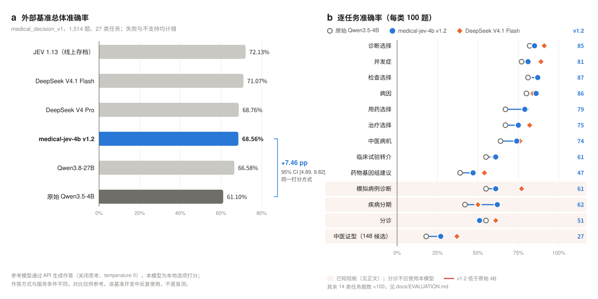
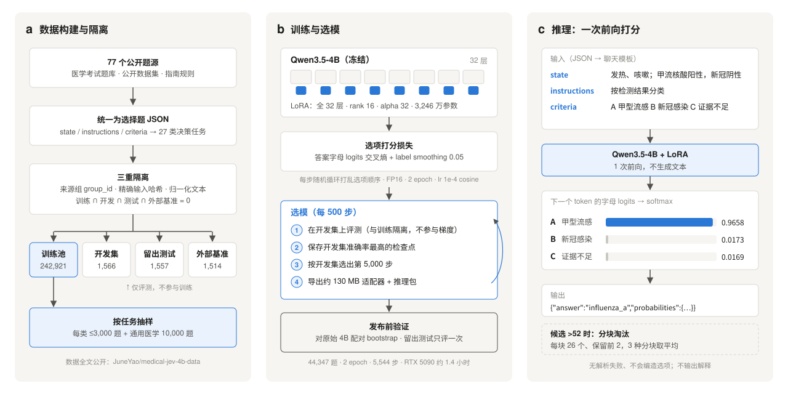

<div align="center">

# medical-jev-4b

**A 4B medical multiple-choice decision model that runs locally on a single GPU**

Give it a case and a set of options. In one forward pass, it picks an answer and returns a probability for every option.

[](https://huggingface.co/JuneYao/medical-jev-4b/tree/v1.1.0)
[](https://huggingface.co/datasets/JuneYao/medical-jev-4b-data)
[](https://github.com/JuneYaooo/jev-healthcare-lab)
[](LICENSE)
[](#quick-start)
[](#disclaimer)

[简体中文](README.md) · **English**

[Quick Start](#quick-start) · [Results](#results) · [Known Weaknesses](#known-weaknesses) · [Reproduce Training](#reproduce-training) · [Full Evaluation](docs/EVALUATION.md) · [Training Method](docs/TRAINING.md) · [Changelog](CHANGELOG.md)

</div>

<br>

| External benchmark accuracy | Default bundle accuracy | vs. base 4B | Direct scoring speed | Adapter |
| :---: | :---: | :---: | :---: | :---: |
| **69.35%** | **67.90%** | **+8.26 pp** | **~54 questions/s** | **130 MB** |
| 1,050 / 1,514, with tournament elimination | 1,028 / 1,514, >52 options counted wrong | 95% CI [5.74, 10.88] | RTX 5090, 1,414 questions | No API fees |

<p align="center"></p>

**Figure 1 | External benchmark results (labels in Chinese).** **a**, Overall accuracy on 1,514 questions, with all questions in every model's denominator. **b**, The 13 task types with 100 questions each. Lines show the change from base 4B to this model, red lines mark a drop below base 4B, and shaded rows are known weaknesses.

> [!WARNING]
> This project is suited to teaching question banks, model evaluation, and offline research. **It must not be used for diagnosis, triage, or treatment decisions for real patients.** Its triage score is below the base 4B model and its probabilities are uncalibrated. See [Known Weaknesses](#known-weaknesses).

## News

- **2026-11-16**: Corrected the denominator of the 1,557-question held-out test and fixed data split isolation and Windows evaluation issues. [Details (Chinese)](CHANGELOG.md)
- **2026-11-07**: Open-sourced the code, full training data, and per-question evaluation records.
- **LoRA v1.1.0**: Current release, an all-32-layer LoRA selected at step 5,500.

## One Call

`state` holds the material, `instructions` holds the decision rule, and `criteria` lists the options. The model only ever picks from the options given.

The request below is a real Chinese example. It describes a teaching case with fever and cough, a positive influenza A PCR, and a negative COVID-19 PCR.

```json
{"id": "teaching_diagnosis",
 "request": {
   "state": {"clinical_question": "教学病例：患者发热、咳嗽，检测报告为甲型流感病毒核酸阳性，新冠病毒核酸阴性。"},
   "questions": {"decision": {
     "type": "choice",
     "instructions": "本题按检测结果分类：甲型流感核酸阳性选择甲型流感，新冠核酸阳性选择新冠感染，两项均阴性选择证据不足。",
     "criteria": {"influenza_a": "甲型流感", "covid19": "新冠感染", "insufficient_evidence": "证据不足"}}}}}
```

Measured output from v1.1.0:

```json
{"id":"teaching_diagnosis","status":"ok","answer":"influenza_a","probabilities":{"influenza_a":0.9658,"covid19":0.0173,"insufficient_evidence":0.0169}}
```

The rule in this question gives the answer directly, so it only demonstrates the format. See [more examples (Chinese)](examples/README.md).

## Quick Start

Requires Python 3.12 and PyTorch built for CUDA 12.8. Verified on Linux with an RTX 5090 32 GB.

```bash
python3 -m venv .venv && source .venv/bin/activate
pip install torch==2.8.0 --index-url https://download.pytorch.org/whl/cu128
pip install huggingface-hub==1.33.0
hf download JuneYao/medical-jev-4b --revision v1.1.0 --local-dir medical-jev-4b
pip install -r medical-jev-4b/requirements.txt
python medical-jev-4b/predict_choices.py --bundle medical-jev-4b \
  --input medical-jev-4b/examples/scenarios.jsonl
```

To run your own data, point `--input` at a JSONL file with one question per line, in the format shown in [One Call](#one-call). Add `--output predictions.jsonl` to save the results.

<details>
<summary><b>More usage: Python API, existing base model, more than 52 options</b></summary>

```python
import sys; sys.path.insert(0, "medical-jev-4b")
from jevtrain.inference import ChoicePredictor
model = ChoicePredictor("medical-jev-4b")
print(model.predict([request]))   # request is the "request" object in the JSON above
```

- Use `--base-model` to point at a base model you already have. Add `--batch-size 1` if you run short of VRAM.
- The release bundle scores up to 52 options directly. For more, use `scripts/predict_choices.py --tournament-above 52` from this repository (tournament elimination).
- The adapter uses a custom `jev-lora-v1` format. Load it with the bundled `predict_choices.py` or `ChoicePredictor`. It is not compatible with PEFT.

</details>

## Why This Exists

Medical workflows contain many tightly scoped decisions: what triage level applies, whether a regimen is contraindicated, which test comes next, whether a patient can be referred to a trial. These decisions don't need a long explanation. They need to be **fast, stable, and directly machine-readable**.

TypeSafe's JEV offers this as an API: pass in context (`state`) and typed questions, and get a structured judgment back. TypeSafe calls it a "System One" model. [jev-healthcare-lab](https://github.com/JuneYaooo/jev-healthcare-lab) tested JEV, DeepSeek, and Qwen on 1,514 medical questions.

So how far can an open, local 4B model go on the same Choice decisions? That is the question this project answers. The model accepts the benchmark's request format directly and is compared on the same questions. This project is not affiliated with JEV or TypeSafe.

## Core Ideas

1. **Score, don't generate.** Options are encoded as A, B, C…, and the model reads only the next-token probabilities of those letters. One forward pass yields the answer and the full distribution, with no invalid options and no text parsing. The trade-off is that there is no explanation.
2. **Balance sampling by task.** The CMB source alone contributes 195,784 questions to the training pool, and training on everything would drown out small tasks. Each task is capped at 3,000 questions, general medical questions at 10,000, for 44,847 training questions in total.
3. **Evaluate strictly.** Train, dev, test, and the external benchmark are isolated three ways: by source group, exact input, and normalized text. Failed and unsupported questions count as wrong, and comparisons with base 4B use a paired per-question bootstrap.

<p align="center"></p>

**Figure 2 | Method overview (labels in Chinese).** **a**, 77 public question sources are unified into multiple-choice JSON and mapped to 27 decision tasks. The four datasets are triple-isolated, then sampled by task. **b**, Qwen3.5-4B is frozen and a LoRA is trained on all 32 layers, with the loss computed only on answer-letter logits. The model is evaluated on the dev set every 500 steps and step 5,500 is selected. Before release it is compared pairwise with base 4B, and the held-out test is evaluated once. **c**, At inference, one forward pass reads the letter probabilities and normalizes them. Above 52 options, tournament elimination runs over chunks.

## Results

| Model | Correct / 1,514 | Accuracy | Answer mode |
| --- | ---: | ---: | --- |
| JEV 1.13 (archived online service) | 1,092 | 72.13% | API generation |
| DeepSeek V4.1 Flash | 1,076 | 71.07% | API generation, thinking off |
| **medical-jev-4b v1.1.0** | **1,050** | **69.35%** | Local option scoring |
| DeepSeek V4 Pro | 1,041 | 68.76% | API generation, thinking off |
| Qwen3.8-27B | 1,008 | 66.58% | API generation |
| Base Qwen3.5-4B | 925 | 61.10% | Local option scoring |
| Qwen3.5-9B | 826 | 54.56% | API generation, 16 rate-limit failures counted wrong |

How to read this table:

- **Benchmark**: [jev-healthcare-lab](https://github.com/JuneYaooo/jev-healthcare-lab) `medical_decision_v1`, triple-isolated from the training data. It was used repeatedly to inspect problems during development, so it is **not a blind test**.
- **Scoring**: Invalid answers, failures, and unsupported questions all count as wrong. The 100 TCM syndrome questions with 148 options use tournament elimination. If they are counted wrong instead (the bundle default), this model scores 1,028 (67.90%) and base 4B scores 907 (59.91%).
- **Comparability**: API models answer by generation while this model scores options locally, and serving conditions differ, so treat the comparison as a reference only. Raw records for the reference models are in `results/clinical-v1` of jev-healthcare-lab.
- **Held-out test**: On 1,557 questions from the training distribution, this model answers 1,307 correctly (83.94%) and base 4B answers 1,174 (75.40%), a difference of +8.54 pp. These figures correct the original record by counting the 2 omitted unsupported questions per model as wrong. The models were not rerun, and the corrected confidence interval cannot be recomputed because per-question group records are missing. The training pool contains the upstream sources of these questions, so this is not a blind test. See the [full evaluation and raw records (Chinese)](docs/EVALUATION.md#训练分布内留出测试).

<details>
<summary><b>Per-task accuracy (13 tasks with ≥100 questions, %)</b></summary>

| Task | Base 4B | **This model** | DeepSeek Flash | DeepSeek Pro | JEV 1.13 |
| --- | ---: | ---: | ---: | ---: | ---: |
| Diagnosis choice | 82 | **89** | 91 | 91 | 89 |
| Complications | 77 | **86** | 89 | 89 | 93 |
| Examination choice | 81 | **86** | 81 | 74 | 88 |
| Etiology | 80 | **85** | 84 | 84 | 84 |
| Medication choice | 67 | **82** | 80 | 72 | 83 |
| Treatment choice | 67 | **77** | 82 | 74 | 78 |
| TCM pathogenesis | 64 | **77** | 76 | 79 | 67 |
| Clinical trial referral | 55 | **62** | 60 | 58 | 53 |
| Pharmacogenomic recommendation | 39 | **60** | 54 | 51 | 55 |
| Synthetic case diagnosis (DDXPlus) | 55 | **60** | 77 | 71 | 70 |
| Disease staging | 42 | **54** | 50 | 53 | 62 |
| Triage | 55 | **40** | 61 | 57 | 63 |
| TCM syndrome (148 options) | 18 | **24** | 37 | 30 | 38 |

All 27 tasks are in [docs/EVALUATION.md (Chinese)](docs/EVALUATION.md#逐任务成绩).

</details>

## Known Weaknesses

| Task | Current state | Cause |
| --- | --- | --- |
| Triage | 40/100, below base 4B; 90% of predictions are "non-urgent care" | Training labels were mostly mapped from physician replies and are dominated by "non-urgent care" |
| Synthetic case diagnosis | 60%, 17 points behind DeepSeek Flash | Its 49 options exceed the training limit of 26, so training contains no such questions |
| TCM syndrome | 24%, every model is below 40% | 148 options, which can only be handled by tournament elimination |
| Disease staging | 54% | Questions depend on detailed staging criteria |

Why is triage worse than base 4B? Most training labels are "non-urgent care", so the model learned to favor that class. **Do not use it for triage.** Its probabilities are also uncalibrated (benchmark ECE 0.13), so they cannot be used directly as risk scores or review thresholds.

## Capabilities and Limits

| Item | Details |
| --- | --- |
| Tasks | 27 types, including diagnosis, etiology, complications, examination, treatment, medication, contraindications, pharmacogenomics, triage, message priority, nursing, nutrition, rehabilitation, and TCM syndrome / pathogenesis |
| Options | Training covers 2–26; the release bundle scores up to 52 directly; more can use tournament elimination (experimental) |
| Length | 1,536 tokens in training; 8,192 tokens in the release bundle |
| Languages | Mainly Chinese, plus English, Japanese, Korean, Portuguese, Spanish, Turkish, and others |
| Speed | RTX 5090, bundle defaults: ~26 s for 1,414 directly scored questions; ~192 s for all 1,514 at batch size 1 with tournament elimination (including ~30 s loading) |
| Deployment | FP16 on a single GPU; the first run downloads a ~9.3 GB base model and verifies its version and hash |

## What's Released

| Content | Location | Details |
| --- | --- | --- |
| Model | [LoRA v1.1.0](https://huggingface.co/JuneYao/medical-jev-4b/tree/v1.1.0) | All-32-layer LoRA (rank 16 / alpha 32, step 5,500), ~130 MB, with standalone inference code; SHA-256 `88c64b00…25b4b6` |
| Data | [medical-jev-4b-data](https://huggingface.co/datasets/JuneYao/medical-jev-4b-data) | Training pool of 242,921 questions (77 sources), plus full dev and held-out sets; each record keeps its source, upstream ID, and license |
| Code | `src/jevtrain`, `scripts/` | Data construction, training, evaluation, and paired comparison |
| Evaluation records | [`docs/results/`](docs/results/README.md) | Per-question predictions for the external benchmark and held-out test |

One note on the data: the original training files were lost, so the published training pool is a reconstruction. It has the same upstream sources and broadly the same per-task scale, but it is not identical row by row. Licenses follow each upstream source, so please check them before use.

## Reproduce Training

```bash
pip install -e . && pip install -r requirements-train.txt
hf download --repo-type dataset JuneYao/medical-jev-4b-data --local-dir work/data/release
jev train --config configs/jev/release/train.json --output runs/train
jev eval  --config configs/jev/release/train.json --checkpoint runs/train/best.safetensors \
  --input work/benchmark/medical_decision_v1.jsonl --max-options 52 --max-tokens 8192 \
  --tournament-above 52 --batch-size 1 --output runs/bench
```

Sampling rules and hyperparameters match the current release, with the data replaced by the public reconstructed pool. Training takes about 1.5 hours on an RTX 5090. See [Training Method (Chinese)](docs/TRAINING.md) for the environment, self-checks, and each step. The two README figures are generated by `python scripts/make_readme_figures.py`.

## Documentation

The documents below are written in Chinese.

| Topic | Document |
| --- | --- |
| Benchmarks, metrics, per-task scores | [EVALUATION](docs/EVALUATION.md) |
| Training flow, hyperparameters, model selection, release gates | [TRAINING](docs/TRAINING.md) |
| Data sources, isolation, limitations | [DATA](docs/DATA.md) |
| Input format and operating range | [INPUT_LIMIT_CHECK](docs/INPUT_LIMIT_CHECK.md) |
| Model card and release report | [MODEL_CARD](docs/MODEL_CARD_V1.md) · [RELEASE](docs/RELEASE_V1.md) |
| Machine-readable results | [docs/results](docs/results/README.md) |

## Disclaimer

This model and its data are for research, teaching, and evaluation only. Training labels were not individually reviewed by clinical experts and probabilities are uncalibrated. Outputs cannot replace professional medical judgment and must not be used for diagnosis, triage, or treatment decisions for real patients.

## Citation

```bibtex
@misc{medical-jev-4b,
  title  = {medical-jev-4b: An Open Local Choice-Scoring Model for Medical Decisions},
  author = {JuneYaooo},
  year   = {2026},
  howpublished = {\url{https://github.com/JuneYaooo/medical-jev-train}}
}
```

## License

The code and LoRA adapter are released under [MIT](LICENSE). The Qwen3.5-4B base model is under [Apache-2.0](https://huggingface.co/Qwen/Qwen3.5-4B/blob/main/LICENSE). Training data keeps the upstream license of each source, and the code license grants no rights to third-party data.
